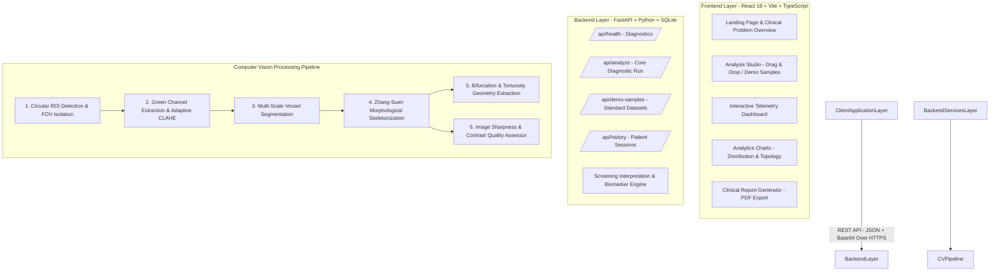

# OcuPulse — AI-Powered Retinal Vessel Analysis

[](https://www.python.org/)
[](https://fastapi.tiangolo.com/)
[](https://opencv.org/)
[](https://react.dev/)
[](https://www.typescriptlang.org/)
[](https://tailwindcss.com/)
[](LICENSE)

> **"See the Vessels. Understand the Risk."**
>
> *AI-Assisted Quantitative Retinal Vessel Segmentation, Centerline Skeletonization, Topological Geometry Extraction, and Clinical Screening Reporting.*

---

## 1. Important Medical Disclaimer

> [!IMPORTANT]
> **OcuPulse is an AI-assisted retinal image analysis and screening tool. It is not intended to provide a definitive medical diagnosis. Results must be reviewed by a qualified ophthalmologist or healthcare professional.**
>
> Quantitative metrics (vessel density, skeleton length, bifurcation counts, caliber indices) represent objective computer-vision measurements. The system is designed for **assistive screening, population health triaging, and clinical research**.

---

# 🔬 OcuPulse — AI-Powered Retinal Vessel Analysis

[](https://www.python.org/)
[](https://fastapi.tiangolo.com/)
[](https://react.dev/)
[](https://opencv.org/)
[](https://www.typescriptlang.org/)
[](https://tailwindcss.com/)
[](LICENSE)

> **"See the Vessels. Understand the Risk."** 👁️‍🗨️
>
> Intelligent, non-invasive retinal image analysis for automated vessel segmentation, topological geometry extraction, and AI-assisted clinical screening.

---

## ✨ Why OcuPulse?

### The Problem
Retinal fundus photographs are a non-invasive window into vascular health, but manual analysis is:
- 🐌 **Time-Consuming**: Manual tracing of thousands of vascular branches
- 🤔 **Subjective**: High inter-observer variability between clinicians
- 🌍 **Inequitable**: Limited access to specialists in remote/underserved regions

### The Solution
OcuPulse automates the entire pipeline—from image ingestion to clinical insight—delivering:
- ⚡ **Instant Results**: Analyze retinal images in seconds, not hours
- 🎯 **Reproducible Metrics**: Objective, computer-vision-based measurements
- 🏥 **Clinical Ready**: Structured reports suitable for population health screening
- 🔬 **Research-Grade**: Validated algorithms with open-source transparency

---

## 🎯 Key Features

### 🖼️ Comprehensive Image Processing
- **Circular ROI Detection**: Automated retinal field-of-view isolation
- **Multi-Scale Vessel Segmentation**: State-of-the-art edge-preserving enhancement
- **Centerline Skeletonization**: Morphological thinning to extract 1-pixel-wide vessel networks
- **Quality Assessment**: Automatic focus, contrast, and illumination scoring

### 📊 Advanced Quantitative Analysis
Extract clinically relevant biomarkers instantly:

| Metric | Description | Clinical Relevance |
|--------|-------------|-------------------|
| **Vessel Density** | % of retinal area occupied by vessels | Vascular health indicator |
| **Centerline Length** | Total length of vessel network | Microvascular complexity |
| **Branch Points** | Number of vascular bifurcations | Arborization assessment |
| **Terminal Endpoints** | Capillary termination points | Vascular remodeling |
| **Caliber Index** | Mean vessel diameter | Microvascular narrowing |
| **Fractal Dimension** | Structural complexity score | Pathological remodeling |

### 🎨 Interactive Dashboard
- **6-Panel Visualizer**: Original → ROI → Enhanced → Segmented → Skeleton → Overlay
- **Split-Slider Comparison**: Before/after analysis visualization
- **Fullscreen Zoom & Pan**: Inspect fine vascular details
- **Analytics Charts**: Distribution plots and topology statistics
- **Session History**: SQLite-backed previous analysis explorer

### 📋 Clinical Reporting
- **Structured Screening Reports**: Non-diagnostic summaries with quantitative metrics
- **Printable PDFs**: Ready for clinical documentation
- **Downloadable Results**: All visualizations and metrics in one package

---

## 🚀 Quick Start

### Prerequisites
- **Python** 3.9+ (3.10/3.11/3.12 recommended)
- **Node.js** 18+ with npm

### Installation

#### 1️⃣ **Clone & Setup Backend**

```bash
# Navigate to project directory
cd ocupulse

# Create and activate Python virtual environment
python3 -m venv venv
source venv/bin/activate  # macOS/Linux
# OR: .\venv\Scripts\Activate.ps1  # Windows PowerShell

# Install Python dependencies
pip install -r requirements.txt

# Start FastAPI server
uvicorn backend.app.main:app --host 0.0.0.0 --port 8000 --reload
```

#### 2️⃣ **Setup Frontend**

```bash
# In a new terminal, navigate to frontend
cd ocupulse/frontend

# Install dependencies
npm install

# Start Vite development server
npm run dev
```

#### 3️⃣ **Access the Application**

Open your browser and navigate to **`http://localhost:5173`**

API documentation available at **`http://localhost:8000/docs`** (Swagger UI)

---

## 🏗️ System Architecture



---

## 📡 API Reference

### Core Endpoints

#### 🏥 **Health Check**
```http
GET /api/health
```
System operational status and version info.

#### 🎯 **Analyze Retinal Image**
```http
POST /api/analyze
Content-Type: multipart/form-data

Parameters:
  - file: Upload fundus image (JPG/PNG)
  - OR demo_id: Use preloaded benchmark sample
```

**Response:**
```json
{
  "analysis_id": "uuid",
  "metrics": {
    "vessel_density": 12.45,
    "centerline_length": 8932,
    "branch_points": 1245,
    "endpoints": 432,
    "caliber_index": 4.2,
    "fractal_dimension": 1.8,
    "quality_score": 0.92
  },
  "visualizations": {
    "roi_mask": "base64_encoded_image",
    "vessel_mask": "base64_encoded_image",
    "skeleton": "base64_encoded_image",
    "overlay": "base64_encoded_image"
  },
  "report": "Structured screening summary..."
}
```

#### 📚 **Demo Samples**
```http
GET /api/demo-samples
```
Returns list of preloaded benchmark fundus images for quick testing.

#### 📋 **Analysis History**
```http
GET /api/history
GET /api/history/{analysis_id}
DELETE /api/history/{analysis_id}
```
Retrieve, explore, or delete previous analysis records.

---

## 🧪 Testing & Quality Assurance

### Run Automated Tests

```bash
# Activate virtual environment
source venv/bin/activate

# Run all tests with coverage
PYTHONPATH=. pytest backend/tests -v --cov=backend

# Run specific test suite
pytest backend/tests/test_preprocessing.py -v
pytest backend/tests/test_segmentation.py -v
pytest backend/tests/test_api.py -v
```

### Test Coverage Includes:
✅ Image validation & boundary protection  
✅ Circular ROI field detection  
✅ Multi-scale vessel segmentation  
✅ Centerline skeletonization & topology  
✅ Geometric feature calculations  
✅ REST API endpoints & error handling  
✅ Clinical report generation  

---

## 🔬 Pipeline Stages Explained

| Stage | Purpose | Input → Output |
|-------|---------|----------------|
| **01. Validation** | Verify image format and dimensions | RGB/BGR Image |
| **02. ROI Detection** | Extract circular retinal field | Binary ROI Mask |
| **03. Enhancement** | Extract green channel + CLAHE contrast boost | Enhanced Grayscale |
| **04. Segmentation** | Detect blood vessels via multi-scale filtering | Binary Vessel Mask |
| **05. Overlay** | Visualize vessel detection on original | Color Overlay |
| **06. Skeletonization** | Thin vessels to 1-pixel centerlines | Skeleton Image |
| **07. Topology** | Extract junctions, endpoints, length | Metric Vectors |
| **08. Quality & Report** | Assess image quality & generate summary | Screening Report |

---

## 🚀 Smart India Hackathon (SIH) Demo Flow

Perfect for 2-minute demonstrations:

1. **Open OcuPulse** → Explore the landing page (problem context + scientific background)
2. **Click "Try Demo"** → Select a benchmark fundus image (Standard, Dense, or Subtle microvasculature)
3. **Click "Analyze Retina"** → Watch real-time progress tracking through all 7 CV pipeline stages
4. **Explore Results Dashboard** →
   - Inspect key metrics cards
   - Test the interactive before/after slider
   - Zoom in on the 6-stage visualizer grid
   - Review analytics charts
5. **Download Report** → Generate and save a clinical screening PDF
6. **Explore History** → Navigate to `/history` to review previous analyses

---

## 🔮 Roadmap & Future Enhancements

### 🤖 Deep Learning Integration
- [ ] U-Net / Attention U-Net vessel segmentation
- [ ] Optic disc & macula segmentation
- [ ] Automated landmark detection

### 📊 Dataset Validation
- [ ] DRIVE (Digital Retinal Images for Vessel Extraction)
- [ ] STARE (Structured Analysis of the Retina)
- [ ] HRF (High-Resolution Fundus)
- [ ] CHASE_DB1

### 📈 Advanced Metrics
- [ ] Vessel curvature analysis
- [ ] Tortuosity quantification
- [ ] Wall-to-lumen ratio estimation
- [ ] Oxygen saturation prediction

### 🌐 Clinical Integration
- [ ] DICOM image support
- [ ] EHR integration APIs
- [ ] Multi-image time-series analysis
- [ ] Population health dashboards

---

## ⚠️ Important Medical Disclaimer

> **OcuPulse is an AI-assisted screening and research tool, NOT a diagnostic device.**
>
> - Quantitative metrics represent objective computer-vision measurements
> - Results must be **reviewed by a qualified ophthalmologist or healthcare professional**
> - Intended for assistive screening, population health triaging, and clinical research
> - **Not suitable for definitive clinical diagnosis without professional review**

---

## 📁 Project Structure

```
ocupulse/
├── backend/
│   ├── app/
│   │   ├── main.py              # FastAPI app initialization
│   │   ├── models.py            # Pydantic models
│   │   └── routes.py            # API endpoints
│   ├── core/
│   │   ├── preprocessing.py     # ROI detection, enhancement
│   │   ├── segmentation.py      # Vessel detection
│   │   ├── skeletonization.py   # Centerline thinning
│   │   ├── geometry.py          # Feature extraction
│   │   └── quality.py           # Quality assessment
│   ├── database/
│   │   └── history.py           # SQLite session manager
│   └── tests/
│       └── test_*.py            # Unit & integration tests
│
├── frontend/
│   ├── src/
│   │   ├── components/          # React components
│   │   ├── pages/               # App pages
│   │   ├── styles/              # Tailwind CSS
│   │   └── utils/               # Helper functions
│   └── index.html               # Entry point
│
└── requirements.txt             # Python dependencies
```

---

## 🛠️ Development Setup

### Environment Variables

Create a `.env` file in the project root:

```env
# Backend
DATABASE_URL=sqlite:///./ocupulse.db
API_HOST=0.0.0.0
API_PORT=8000

# Frontend
VITE_API_URL=http://localhost:8000/api
```

### Code Style & Linting

```bash
# Python formatting
black backend/

# Type checking
mypy backend/

# Frontend linting
cd frontend && npm run lint
```

---

## 🤝 Contributing

We welcome contributions! Please follow these guidelines:

1. **Fork** the repository
2. **Create a feature branch** (`git checkout -b feature/amazing-feature`)
3. **Commit your changes** (`git commit -m 'Add amazing feature'`)
4. **Push to the branch** (`git push origin feature/amazing-feature`)
5. **Open a Pull Request** with a clear description

### Code of Conduct
- Be respectful and inclusive
- Focus on scientific accuracy for medical features
- Write tests for new functionality
- Document your changes thoroughly

---

## 📚 Research & References

OcuPulse builds upon established computer vision and retinal imaging research:

- **Vessel Segmentation**: Multi-scale morphological filters (Frangi vesselness)
- **Skeletonization**: Zhang-Suen thinning algorithm for centerline extraction
- **Quality Assessment**: Laplacian variance focus, contrast RMS, illumination uniformity
- **Clinical Metrics**: Validated against ophthalmology literature

---

## 📄 License

This project is licensed under the **MIT License** — see the [LICENSE](LICENSE) file for full details.

```
Copyright (c) 2024 OcuPulse Contributors

Permission is hereby granted, free of charge, to any person obtaining a copy
of this software and associated documentation files (the "Software"), to deal
in the Software without restriction...
```

---

## 💬 Support & Contact

- 📧 **Questions?** Open an issue on GitHub
- 🐛 **Found a bug?** Report it with a detailed description
- 💡 **Feature request?** We'd love to hear your ideas!
- 🔗 **Need documentation?** Check the [Wiki](wiki/)

---

## 🙏 Acknowledgments

OcuPulse was developed with inspiration from the medical imaging and computer vision communities. Special thanks to:

- **Ophthalmology researchers** for domain expertise and clinical validation
- **OpenCV contributors** for robust image processing tools
- **FastAPI & React communities** for excellent frameworks
- **Smart India Hackathon** for platform and opportunity

---

<div align="center">

**Made with ❤️ for better vision health**

contect : 
shrikargs7@gmail.com

*"See the Vessels. Understand the Risk."* 👁️

[⬆ Back to top](#-ocupulse--ai-powered-retinal-vessel-analysis)

</div>
